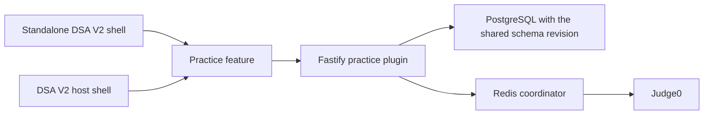

# Standalone Practice and Placement Platform

**Build plan · updated 21 November 2026**

Build the platform in a new repository outside both DSA V2 project folders. Use the current DSA V2 interface and engineering conventions from the first screen. Reproduce Code Club’s Judge0 execution behavior in TypeScript, then deliver the feature and its database migrations for installation inside DSA V2. Develop and test with a separate database, Redis instance or namespace, credentials, and accounts.

The standalone platform already runs the core Judge0 workflow, and the installer has passed rehearsals in disposable DSA V2 frontend and backend copies. This revision focuses on the work needed to close feature parity and package the final merge kit. See [the remaining delivery plan](#9-remaining-delivery-plan) for the current sequence and acceptance gates.

| Decision | Build target |
| --- | --- |
| Product home | A separately deployed Practice and Placement site during development. DSA V2 mounts the same modules at `/practice` after the merge. |
| Interface | Current DSA V2 navigation, Syne and JetBrains Mono, light and dark theme tokens, practice layout, and UI components. |
| Execution | Code Club’s function contracts, Judge0 language drivers, comparison rules, execution limits, and separate Run and Submit operations. |
| Application stack | DSA V2 React and TypeScript frontend, Fastify and TypeScript API, PostgreSQL with Prisma, Redis, and DSA V2 authentication. |
| Merge | A frontend mount, a Fastify plugin, shared DTOs, additive migrations, configuration, and content import. Rehearse those steps while developing. |

## 1. Sources and REA evidence

Pin these inputs in the new repo as a compatibility baseline. Record both the commits and the file digests because the standalone build and the eventual DSA host need a common point of comparison.

| Reference | Inspected revision or artifact | What it governs |
| --- | --- | --- |
| DSA V2 frontend | `7797041c66e80f56c105b553f0b7cf3fe61b1a36` | UI, route ownership, client, auth provider, theme provider, and the frontend lockfile. |
| DSA Visualiser Backend | `88a1d08950526dea58ec3a48113da114c9df0ec6` | Prisma baseline, API prefixes, JWT claims, role guards, error handling, and progress consumers. |
| Code Club source | `20f5919c4efa5550a937898471dda7d17edecf92` | The reference for the judge, problem formats, and product rules. [Pinned source tree](https://github.com/SSVP-debug/code-club/tree/20f5919c4efa5550a937898471dda7d17edecf92) |
| Code Club published client | Eight JavaScript chunks from the public deployment, including the entry, catalogue, solver, language selector, contests, recruiter, and TPO pages. | Independent evidence of the client structure. [Published entry chunk](https://code-club-one.vercel.app/assets/index-BbS-UgPA.js) · [Published solver chunk](https://code-club-one.vercel.app/assets/ProblemDetailsPage-DtF1fw3k.js) |

**REA pass completed for this plan.** REA’s `analyze_javascript_application` parsed eight public JavaScript files, totalling 476,795 bytes, with zero parse failures. The retained `inspect_analysis_view` module page identified the solver and other feature chunks. A focused view recovered a solver import of the identity module. A direct inspection of the same solver bytes located `/judge/run` and `/judge/submit`. The entry bytes contained `/problems/:slug`, `/recruiter/dashboard`, and `/tpo/dashboard`.

| REA record | Identifier |
| --- | --- |
| Application evidence | `ev_e2d626556823b737d866efb8450de1bb7992790d949003901d5d5776b72f30dd` |
| Module inventory view | `ev_741717f54d2eedf4762887f7aeaf19a12ea32e4bcb814fd28254e82914cb7214` |
| Solver module view | `ev_1fb848ea4e23f53ce498cdf02a1ee3b86f86c5d1e19514fefa8aedef7c24f38d` |
| Entry chunk SHA-256 | `880ee26eb260ca37e76fb816f76025614ec4a0a1fdbfa397181dd3b9d9c489ea` |
| Solver chunk SHA-256 | `da6084464d7393182f500aa8539adb0343df7b62b9a92b3cbfe4796a74d18096` |

The REA graph had partial semantic coverage. The targeted graph lookup did not resolve the judge API literal through the client wrapper. Treat the literal check as static evidence of the two calls. The deployed server configuration, exact relationship between published bytes and the source commit, authenticated flows, and grading results remain unverified by this capture. Use the pinned source and controlled execution tests for those behaviors.

**Use REA during implementation.** Keep a short evidence log with the captured artifact digest, tool, finding, and limits. Analyze the corresponding built solver from each release candidate to check the route and client request wiring. When a UI behavior depends on runtime state, use REA’s browser tools on a dedicated local test browser with synthetic accounts. Select the test tab with `list_browser_targets`, then use `analyze_web_bundle` or a bounded `observe_web_session` capture for the question at hand. Compare the expected click-to-request flow for Run, Submit, history, and navigation with the browser tests. Use controlled Judge0 fixtures and an isolated Judge0 instance to verify server behavior. Judge parity is a test result.

## 2. The UI comes from DSA V2

Use the current implementation as the design reference. Copy or adapt DSA V2 components into the standalone shell during development, and consume the host components at integration. Use Code Club’s journeys and behavior as product requirements.

| Part of the UI | DSA V2 reference | Standalone design |
| --- | --- | --- |
| Navigation | `frontend/src/components/Menu.tsx` and `frontend/src/app/App.tsx` | Use the current DSA rail, icon treatment, active state, and compact navigation. Limit links in standalone mode to mounted routes. The embedded module uses the existing host navigation. |
| Theme | `frontend/src/styles/index.css`, `frontend/src/contexts/ThemeContext.tsx`, and `frontend/tailwind.config.js` | Use Syne for UI text and JetBrains Mono for code and technical labels. Use `--surface-root`, `--surface-panel`, `--surface-card`, `--border-default`, `--text-primary`, `--text-muted`, and `--accent`. The current dark root is `#020617` with cyan `#22d3ee`. The light root is `#f8fafc` with sky `#0284c7`. Read these from the theme as the shared source of each color. |
| Catalogue | `frontend/src/pages/problems/ProblemsPage.tsx` | Preserve the DSA V2 practice header, filter controls, difficulty chips, and compact problem rows. Add status, bookmarks, and a meaningful empty state. Use a 3D link only where a reviewed visualizer mapping exists. |
| Solver | `frontend/src/pages/problems/ProblemSolvePage.tsx` | Keep the full-width DSA V2 workspace. Start from its roughly 42/58 description/editor split and the bottom result pane on desktop. Use the same surface and border treatments, Monaco `vs-dark` or `light` theme, and resizable panel library. |
| Placement dashboards | `frontend/src/pages/dashboard/StudentDashboard.tsx`, `frontend/src/pages/dashboard/TeacherDashboard.tsx`, and `frontend/src/components/layouts/AdminLayout.tsx` | Use DSA V2 card, table, form, chart, and sidebar patterns for student practice, recruiter, placement team, and practice administration. Route access comes from the appropriate workspace permission. |

Design the working screens in this order.

1. **Practice catalogue.** Search by title or topic and filter by difficulty, topic, status, and bookmark. Keep filters in the URL where they affect sharing or the back button. Show loading, no results, unavailable content, and a retry state. Show a concise solved indicator with text or an accessible label.
2. **Solver.** Keep problem statement, examples, constraints, incremental hints, editorial, and submission history reachable from the workspace. Save editor drafts by account, problem, and language. Keep the selected language and panel layout across reloads. Scope local drafts so switching accounts on a shared browser cannot display someone else’s code. Provide reset with a recoverable draft or confirmation.
3. **Run and Submit.** Run is the secondary action for visible tests. Submit is the primary action and displays the committed verdict. Use distinct result labels for example tests, accepted, wrong answer, compiler or runtime errors, and judge unavailability. Show visible-case input, expected output, and actual output when available. Hidden tests show only safe aggregate feedback. Keep the source in the editor if the service fails.
4. **Narrow screens.** Reuse the DSA navigation breakpoint. Replace the split editor layout with Problem, Code, and Results tabs when pane widths become impractical. Keep actions reachable when the editor or result scrolls, preserve draft and active tab on resize, and check keyboard and touch use.
5. **Progress and workspaces.** Extend the catalogue and solver with practice progress before introducing separate dashboards. Use the current student dashboard style for activity and paths, teacher/admin patterns for cohorts and assignments, and DSA V2 forms and tables for candidate and skills-test views.

The frontend shell owns one `BrowserRouter`, one `AuthProvider`, and one `ThemeProvider`. The theme provider applies `data-theme` and the host dark class. Feature CSS lives under the feature root and uses Tailwind 3 and DSA variables. Load Monaco with the solver route. Keep proper focus handling, labeled buttons, accessible result announcements, and text equivalents for color-coded verdicts.

Capture reference and candidate screenshots in both themes at desktop and phone widths before accepting a screen. Review navigation, typography, density, editor sizing, focus, empty states, and results against the DSA V2 references. Recheck the same screens after mounting inside the host.

## 3. Standalone repository and exact stack baseline

Use `D:\PROJECTS\CodeClub` as the standalone Git repository for this project.

| Area | Observed DSA baseline |
| --- | --- |
| Build and CI | Node 22 in frontend and backend CI. Pin the same Node major and the package-manager behavior used by the host lockfiles. |
| Browser workspace | React `19.2.3`, TypeScript `5.9.3`, Vite `7.3.1`, Tailwind `3.4.19`, React Router `7.12.0`, Monaco React binding `4.7.0`. |
| Backend workspace | Fastify `5.12.5`, TypeScript `5.9.3`, Prisma CLI `7.10.0`, Prisma client and PostgreSQL adapter `7.8.0`, Zod `4.4.3`. Match strict ES2022 ESM and use Fastify’s `inject` for API integration tests. |
| Database and coordination | PostgreSQL 16 and Redis 7 in the DSA backend’s checked-in development and CI configurations. Use Prisma’s existing driver adapter and the same SQL conventions. |
| Frontend connection | Tailwind 3 config and aliases, Axios `api` client, `VITE_API_URL` defaulting to `/api`, and the existing refresh flow. |
| Judge0 | Configured Judge0 endpoint with the pinned language registry and tested runtime versions. Record the actual engine version and registry verified for the chosen deployment. |

These versions describe the inspected lockfiles. During bootstrap, prove that the observed Prisma CLI, client, and adapter combination installs, generates, applies migrations, and runs. If a common version is needed, include the exact lockfile diff in the integration kit and test it in both modes. Repeat this check if DSA advances beyond the pinned commits.

```text
CodeClub/
  frontend/src/app/                  standalone bootstrap and standalone nav
  frontend/src/features/practice/    catalogue, solver, history, practice admin
  frontend/src/features/placement/   college workspaces and recruiting
  frontend/src/features/community/   competitions, engagement, contributions
  shared/src/types/                   browser-safe DTOs and request contracts
  backend/src/modules/practice/      Fastify plugin, judge, progress, catalogue
  backend/src/modules/placement/     assignments, skills tests, placement roles
  backend/src/modules/community/     contests, scoring, challenges, rewards
  backend/src/types/                 backend copy of generated shared types
  backend/prisma/                     pinned DSA base and ordered migrations
  problem-bank/                       server-side authored problems and tests
  tests/parity/                       controlled Judge0 fixtures and comparison
  tests/merge-rehearsal/               installation against DSA snapshots
  integration/                       file map, patches, preflight, data mapping
  docs/evidence/                     REA evidence, parity results, decisions
```

Use the DSA frontend’s npm workspace layout for `frontend` and `shared`. Keep the backend package independently buildable. Generate any duplicated TypeScript DTO declarations from one canonical contract, check them into the delivery artifacts, and fail CI on drift. Keep Zod route validation in the backend. The integrated backend must build with its existing `rootDir` and package layout without reaching into a sibling checkout.



Each deployment supplies its own infrastructure instances. The frontend feature accepts the existing API client and host navigation capabilities. The standalone shell provides matching auth, theme, and routing adapters. The Fastify module receives its Prisma client, Redis coordination, host guards, logger, and validated judge configuration. Follow the host route/service/repository pattern using explicit DTOs. Standalone and embedded tests exercise the same exported components and services.

Local compose supplies a practice PostgreSQL database and a practice Redis environment. Judge0 uses a dedicated local or authorized staging service. The environment template names only public frontend configuration and server-side placeholders. Pin safe synthetic student, teacher, university, classroom, and feature-role fixtures. Bind local services to loopback and keep production connection strings out of test config. The standalone startup checks must work from a clean clone with both DSA directories absent.

### Baseline fingerprints

| File | SHA-256 of the inspected checkout bytes |
| --- | --- |
| Frontend root `package-lock.json` | `df3a481aec24bc2e0d23c93abb0916348d8ad8dea56f7886cf3b76a41fee0a99` |
| Backend `backend/package-lock.json` | `bc0f6ed5e15b329b02e382797287c044770b7b264a2efb2d2be3add2a78bb9ab` |
| Backend `backend/prisma/schema.prisma` | `19d29889f2a516b043ed4410c1fc64113a436e6ef12d3cfb022ab2ab6bf7d926` |

Record source commits, migrations, and lockfiles in `integration/baseline.json`. Hash logical schema and tracked bytes consistently in CI so line-ending differences can be distinguished from a real schema change.


## 4. Schema and migration design

Start from the pinned DSA V2 `schema.prisma` and existing migration history. Both standalone and embedded environments use **the same schema revision**, defined as the DSA baseline plus the practice migrations. Apply the same migration directories in the same order. Use `uuid` and `@db.Uuid` for DSA-facing identities, `@db.Timestamptz(3)` for timestamps, snake case database mappings, and the host’s enum conventions. Prefer nullable additions and explicit backfills when an existing table needs a new field.

| Host data | Binding in the new module |
| --- | --- |
| `User`, `Session`, and `PracticeAccountRestriction` | Reuse DSA’s account UUIDs, login, refresh, and approval. An additive restriction lets super admins suspend and restore Practice access, with the reason recorded in DSA’s audit log. |
| `University`, `Student`, `Teacher`, `Class`, `ClassStudent` | Reuse university and academic relationships. Link placement cohorts and staff permissions as domain records. |
| `Problem`, `Syllabus` | Keep existing problem UUIDs, slugs, publication fields, and syllabus links. Attach Judge0 content to a reviewed `Problem.id`. |
| `HiddenTestCase` | Continue serving consumers of the existing per-language `inputCode` harness format until each affected problem has a verified structured conversion. |
| `StudentProgress` and `RoadmapProgress` | Keep their existing unique keys and update them from verified practice results for eligible students and linked roadmap rows. |
| `InterviewSession` | Retain its current execution and problem lookup during practice rollout. Evaluate future replacement as its own change. |

### Core additions

The following names and fields are proposed implementation contracts. Freeze the final Prisma diff and API mappings in the standalone repo during the foundation milestone.

| Model / table | Fields | Constraints and purpose |
| --- | --- | --- |
| `PracticeProblemContract` / `practice_problem_contracts` | `problemId`, `sourceKey`, `sourceRevision`, `sourceNumber`, `functionName`, `parameterOrder`, `paramTypes`, `returnTypes`, `comparisonMode`, `operationSequence`, `state`, `visibility`, `hiddenSetEnabled`, `contentVersion`, `contractDigest`, timestamps | `problemId` is the PK and FK to `Problem`. Source identity is stable and unique when provided. Store type maps and operation metadata as validated JSON. Distinguish draft, published, and paused states from catalogue versus contest visibility. |
| `PracticeTestCase` / `practice_test_cases` | `id`, `problemId`, `visibility`, `position`, `inputJson`, `expectedOutputJson` | Unique `(problemId, visibility, position)`. Store the validated serialized JSON values in text to round-trip any key order the comparator uses. Store argument order explicitly and verify nested values, null, and the reference JS number representation. Return visible DTOs through explicit projections. |
| `PracticeSubmission` / `practice_submissions` | `id`, `userId`, `problemId`, `problemVersion`, `judgeProfileVersion`, `language`, `verdict`, `code`, `passed`, `total`, `visiblePassed`, `hiddenPassed`, `runtimeMs`, `memoryKb`, `elapsedMs`, safe diagnostic summary, timestamps, `idempotencyKey`, request digest | FK to `User` and `Problem`. Unique `(userId, idempotencyKey)`. Index `(userId, createdAt, id)` and `(problemId, verdict)` for history and aggregate stats. Store separate execution and request timers. Store enum keys while mapping to Code Club’s public verdict labels. |
| `PracticeProgress` / `practice_progress` | `userId`, `problemId`, `status`, `attemptCount`, `acceptedCount`, `firstAttemptAt`, `lastAttemptAt`, `firstSolvedAt`, runtime and memory metrics | One row per user and problem. Use DSA progress status names and domain rules for verified solve state. The `User` FK supports teacher practice while DSA student projections continue to require a student profile. |
| `PracticeProblemBookmark` / `practice_problem_bookmarks` | `userId`, `problemId`, `createdAt` | Composite uniqueness supports idempotent save and remove. |

A content release adds catalogue metadata such as pattern, provenance, related problem links, and editorial content through a practice extension if it has no suitable field on `Problem`. Code Club’s numeric identifier is metadata. Use UUIDs for domain relations and the canonical slug for URLs.

Load a consistent contract version together with its ordered cases before grading, and release the database connection before executing any code. Record the judged version with the result. Update grading fields and the ordered case set atomically when publishing a change. Bump the version when the entry point, ordered tests, comparison behavior, or type contract changes. Keep the authored revision and digest for replay. Cosmetic metadata has its own edit timestamp. Active contests and timed tests pin scoring rules and a problem version. For the first schema revision, defer changes to a pinned suite until the active assessment window ends. Record this publication rule and test concurrent authoring and assessment.

Use check constraints for nonnegative counts and durations and for pass counts within the relevant totals. Keep user and university scoping explicit on private records. Use repeatable migrations for rehearsal and production. Preserve existing DSA data before and after each migration and verify the legacy API shapes.

### Extensions by release

| Domain | Planned schema extensions |
| --- | --- |
| Learning | Private problem notes, playlists and ordered items, reflections tied to submissions, preferences, path completion, daily and weekly completion. Use verified progress to calculate recommendations and activity. |
| Competition | Contest and ordered problem list, participant/membership, verified score entries, battle rooms, and room membership. Link scores to submissions and preserve availability windows. |
| College | Placement university profile, scoped staff membership, cohorts, membership imports, assignment audiences, completions, verification reviews, and audit records. Map academic classes only when the membership rules match. |
| Recruiter | Recruiter profile and verification state, candidate profile visibility and consent, recruiter interest, skills test, candidate invitation and timing, and scoring. |
| Community | Achievements, reward ledger, credits and redemption, referrals, ambassadors, contributions, feature requests and votes, and moderation state. |
| Publication and providers | Certificates with stable verification codes, curated opportunities, notifications, administrator-managed entitlement records, and provider event deduplication. |

Use the existing DSA style for FKs, ownership and deletion policies. Keep competition, placement, and public profile permissions domain scoped. Document feature-specific field mappings and indexes in the schema spec for each release.

## 5. Identity, roles, and access

The standalone shell uses a compatible DSA V2 login and registration flow against its isolated database. Reuse the contract of `/auth/login`, `/auth/me`, `/auth/refresh`, and `/auth/logout`, including the Bearer access token, its `userId` and `role` claims, device binding where enabled, and the HTTP-only refresh cookie. Use the host `AuthProvider` and Axios refresh path once integrated. Validate permissions in Fastify and keep browser gates for navigation.

| Person | Access policy |
| --- | --- |
| Student | Published catalogue, Run, Submit, own history and drafts, authorized assignments and competitions. Verified submissions can update the DSA student and linked roadmap records. |
| Teacher | Practice and own history. Keep authoring and academic reporting under the DSA teacher and verification guards. |
| DSA admin | Existing DSA administration plus practice administration granted through the relevant host permissions. University boundaries still apply. |
| Placement officer | University-scoped placement permissions with verification and an auditable membership, including staff roles and cohort access. |
| Recruiter | Verified recruiter profile and scoped candidate search, interest, and skills tests. Candidate visibility and invitations govern available records. |
| Guest | Optional public catalogue and rate-limited visible Run on a deliberately enabled guest surface. Require a session for Submit, history, scoring, and saved account progress. |

The pinned DSA schema declares `STUDENT`, `TEACHER`, `ADMIN`, and `SUPER_ADMIN`. Add placement workspace membership for eligible campus staff. The placement milestone must settle an additive account-role path for external recruiter and placement officer accounts, including JWT/API type updates and an audit of exhaustive guards, account creation, and navigation. Use round-trip tests for all role claims against the host fixture. Apply DSA’s signed-in Practice policy by default in the integration. Test Code Club’s optional guest behavior behind its own switch before enabling it on any surface.

## 6. Routes and API contracts

Use a fixed module route shape in both shells. The standalone home can link directly to `/practice`. The DSA host mounts the same module with these paths.

| Route | Expected behavior after merge |
| --- | --- |
| `/practice` | New practice catalogue and links to practice workspaces. |
| `/practice/solve/:slug` | Canonical solver route. Open the same module with the same slug and relevant search parameters. |
| `/solve/:slug` | Backward-compatible entry for existing roadmap and public problem-detail links. Preserve parameters and the authenticated return target. |
| `/student/practice` and `/student/problems` | Compatibility entries delegating to the new practice catalogue. |
| `/practice/paths`, `/practice/contests`, `/practice/placement/*`, `/practice/admin/*` | Scoped module routes as those releases ship. The existing DSA layouts provide the host navigation. |
| `/problems` and `/problems/:slug` | DSA’s existing public and 3D problem routes. Practice pages link to them through the reviewed visualizer mapping. |

Register the Fastify plugin under the host’s `/practice` prefix in `backend/src/app.ts`. The frontend uses `/api/practice` through the existing API client. Keep DSA’s existing problem and interview API routes available during the rollout. `SessionPage.tsx` currently reads `/student/problems`, so treat compatibility of that list and detail response as a merge test.

Use one server-controlled practice rollout setting consumed by the route mount and the judge routes. During migration, route known legacy-only slugs to the existing solver. Route converted, enabled problems to the Judge0 solver. Cover both outcomes through the catalogue and `/solve/:slug`. Resolve guest Run and placement, membership, and opportunity feature switches independently. Use Code Club’s `B2B_ENABLED`, `MONETIZATION_ENABLED`, and `OPPORTUNITY_RADAR_ENABLED` rules as references for the feature matrix. Membership access uses administrator grants and quota rules.

| Endpoint relative to `/api/practice` | Contract and effect |
| --- | --- |
| `GET /problems` | Published catalogue with supported filters, stable order and cursor. Return a list DTO and viewer status where applicable. |
| `GET /problems/:slug` | Statement, constraints, examples, visible tests, hints, supported starter code, allowed language keys, and eligible 3D link. Return a generic 404 for unavailable or inaccessible problems. |
| `GET /problems/:slug/editorial` | Serve the actual editorial for an eligible problem and viewer using the reference access rules. |
| `GET /languages` | Enabled registry entries and editor settings. Intersect this with each problem’s valid starter templates in the solver. |
| `POST /judge/run` | Accept problem slug, language, source, and the reference visible-case request shape. Return ordered per-case feedback, timing and memory fields when available, and `compileFailed`. No progress write. |
| `POST /judge/submit` | Accept slug, language, source, and an idempotency key. Load the stored contract and ordered visible and hidden tests. Return the committed submission ID, Code Club verdict, pass counts, safe visible feedback, and progress outcome. Bind optional contest or skills-test context only after server validation. |
| `GET /submissions` and `GET /submissions/:id` | Owner-scoped paginated history and detail with source and safe verdict summaries. |
| `PUT /bookmarks/:problemId` and `DELETE /bookmarks/:problemId` | Idempotent bookmark operations scoped to the signed-in user. |
| `GET /progress` | Read the practice progress summary and filtered list for the current user. |
| `GET /health` | Sanitized health and execution readiness. Required for standalone deployment and integration preflight. |

Define request validation and output projections in the same milestone as the client. Keep Code Club’s `testcases` and `visibletestcases` naming in the compatibility layer where required. Preserve the reference maximum source length of 50,000 characters and caps of ten Run cases and twenty cases in the legacy Submit request shape. Treat case count limits on authored decks as a separate validator. The new Submit flow uses the stored catalogue suite, with the compatibility field accepted only as request metadata. For ordinary UI requests this is the same visible suite. Cover the difference for stale or modified input in the discrepancy record.

Use DSA’s error envelope and status codes for authentication, authorization, validation, and infrastructure failures. Keep judge verdicts as graded responses with stable status labels. Document the shape for an unavailable engine, a paused hidden suite, and a missing suite so the frontend shows the correct recovery action. Public response schemas include only fields intended for that caller and mode.

## 7. Code Club Judge0 implementation

Use the pinned reference execution modules and tests as the behavioral specification. Translate the runner and drivers to strict TypeScript and wire HTTP, identity, queue storage, and persistence to the corresponding DSA V2 services. Keep pure driver generation and comparison functions testable independent of Fastify and PostgreSQL. [Reference judge controller](https://github.com/SSVP-debug/code-club/blob/20f5919c4efa5550a937898471dda7d17edecf92/backend/controllers/judgeController.js) · [Reference compiler transport](https://github.com/SSVP-debug/code-club/blob/20f5919c4efa5550a937898471dda7d17edecf92/backend/controllers/compilerController.js)

| Language key | Reference Judge0 ID | Driver coverage |
| --- | ---: | --- |
| `python` | 71 | Function calls, native serialization, structured inputs, operation sequences |
| `javascript` | 63 | Same modes using the JavaScript conversion rules |
| `java` | 62 | Declaration-aware compilation and structured drivers |
| `cpp` | 54 | Declaration-aware compilation and structured drivers |
| `c` | 50 | C-specific array, size and return conventions, with supported design shapes |
| `typescript` | 74 | TypeScript driver, serialization and supported structured inputs |

All six entries are enabled in the pinned registry. A particular problem exposes only its validated language templates. Confirm the ID and runtime at the selected Judge0 deployment before releasing each language. Read the function entry point, supported types, argument order, structured tree/list and operation-sequence formats, and comparator from the versioned server contract. Preserve the reference’s declared-versus-inferred type behavior in the golden fixtures.

| Execution setting | Reference default |
| --- | --- |
| CPU and wall clock limits | 2 seconds CPU, 5 seconds wall per execution |
| Memory, process, and file limits | 256,000 KB memory, 60 processes/threads, 1,024 KB file size |
| Judge0 transport | Attempt to obtain the completed submission result with `wait=true`. Use `base64_encoded=true` on the URL and encode source and stdin. Decode output fields before classifying. |
| Network deadline and retries | 20-second deadline per request. Up to three attempts on the reference transient branches with bounded backoff. Keep result state and infrastructure errors distinct. |
| Capacity | Shared Redis lease, reference cap of 8, acquisition deadline of 20 seconds, 30-second default lease renewed during execution. Explicit local queue mode is for a single server process. |

Use a dedicated Judge0 deployment with engine and runtime versions recorded for rehearsal. Store provider headers and URLs in backend configuration. Use the shared Redis coordinator across replicas and scoped keys for standalone and embedded deployments. Test acquisition failure, lease expiry and renewal, throttling, and executor outage. Align frontend and gateway timeouts with observed multi-case execution budgets and the tested retry behavior.

**Run flow.** Validate identity or configured guest policy, problem, language, source, and visible-case data. Load the problem contract and apply its availability and access rules. Execute visible cases in the reference order and stop on the same compile or service/runtime conditions. Return the expected and actual values for visible cases using the same comparison logic that Submit uses. Send source to the backend and configured Judge0 service.

**Submit flow.** Load the versioned contract, visible suite, and hidden suite in order. Require a grading-ready hidden set. The reference checks the first case on its own. After it passes, remaining cases can run under the shared concurrency cap. Resolve the first failure by original test order, even when cases finish out of order. Preserve first-failure attribution, prefix pass counts, and visible/hidden count semantics. Resolve SQL persistence after the execution result is available.

**Comparison.** Follow the reference’s JSON parse and serialization behavior. For non-JSON responses, apply the reference string comparison after trimming and converting CRLF to LF. Exact comparison keeps structural order according to that serializer. Unordered comparison treats the top-level array as a multiset, retaining duplicates and nested element order. Add fixtures for reordered arrays, duplicate values, nested values, null, booleans, line endings, and object key order. Port `operationSequence.enabled` and the `all` and `returningOnly` result modes.

**Verdicts.** The reference model includes Accepted, Wrong Answer, Compilation Error, Runtime Error, Time Limit Exceeded, and Judge Error. The pinned Submit controller does not explicitly emit a dedicated Time Limit Exceeded label. Capture the actual reference timeout and memory responses in fixtures before deciding on any mapping change. Preserve the status definitions for history and UI. Use a successful graded response plus all required cases passing as the precondition for accepting a solution.

**Acceptance evidence.** Run the reference and the port with the same controlled Judge0 responses and synthetic source, contracts, and tests. Compare generated requests, case order, normalized values, feedback visibility, verdict, and pass counts. Compare performance metrics with tolerances for real execution and use controlled values in exact tests. Run real compile, run, and submit smoke cases for every supported language and supported input shape on the exact Judge0 environment for launch.

## 8. Content authoring and legacy compatibility

Reuse the proven authoring layout for new problem content. Verify reuse rights for the reference code and content before importing them. The inspected tree contains no repository-wide LICENSE or COPYING file. Use original problems and fixtures for the first vertical slice and preserve the behavior specification independently of content provenance. The reference tree contains 250 problem folders with metadata. Keep a manifest of the authorized corpus, with rights, source version, and review status for each imported entry.

```text
problem-bank/<slug>/
  meta.json                  source ID, entry point, language and comparator contract
  description.md
  constraints.json
  examples.json
  hints.json
  editorial.md
  testcases.json             visible examples used by Run and by Submit
  hidden-testcases.json      server-only grading data
  starter/                   per-language source templates
```

Run the importer in dry run mode by default. Validate mandatory files, title and slug identity, parameter order, language starter and driver combinations, operation sequences, expected JSON, visible and hidden counts, and publication rules. Produce a report with new, unchanged, updated, conflicting, unsupported, and blocked entries. Make the write path idempotent and version-aware. Check in a reviewed mapping for matches against DSA’s existing catalogue, including explicit 3D destinations. Keep hidden test files outside the Vite import graph, static output, and any offline cache.

Existing DSA rows are matched using an approved source-to-UUID map. Preserve existing UUIDs, slugs, syllabus and roadmap links, teacher ownership, and previous progress. Convert an existing Piston problem only after the tested structured suite covers its intended cases. Keep its compatibility route available until conversion succeeds. Update teacher authoring with contract validation, visible-case preview, and publish controls for converted problems. The authoring workflow keeps teacher ownership and records content-version changes. Keep contest-only and draft content out of generic legacy list/detail routes. In particular, set legacy `Problem.isPublished` consistently with the older public visibility query and authorize contest-only access through the new module’s own rules. Test both entry points.

### Write progress from the verified verdict

1. Judge the request and derive a result from its explicit contract version and test suite.
2. Commit a submission row, update practice progress, and apply eligible student and linked roadmap updates within a transaction. Use a deliberate submission key and request digest to handle retries and concurrent requests.
3. Record dependent award and scoring events against unique submission or first-solve identifiers. Apply eligible first-solve rewards once. Make downstream delivery retryable after commit.
4. Refresh the learner’s result, history and progress from the committed response. Keep a previous solve when a later attempt fails. Report an execution result and a save failure distinctly if the transaction cannot commit.

Treat historical DSA completion as legacy progress. Preserve it in dashboard and roadmap views. New Judge0-verified submissions carry their own provenance. Keep teacher practice history under the teacher’s `User` without assuming a `Student` association. Store learning time, runner duration, and infrastructure latency as distinct measures. Use the source’s IST calendar-day boundaries for streaks and challenges, with explicit midnight-boundary test fixtures.


## 9. Remaining delivery plan

The standalone platform and pinned DSA V2 installer are running and rehearsed. Roughly 20–25% of delivery work remains, excluding payment gateways. The 250 reference folders pass structural conversion, 67 local automated checks pass, and the standalone and paired DSA V2 browser suites pass. A live Judge0 smoke run passed both sample cases for the demo exercise. Catalogue-wide runtime verification and live AI and mail setup are still open. [Current feature parity and evidence](integration/codeclub-parity.md)

Keep all implementation and test data in the standalone CodeClub repository and disposable copies of the DSA V2 hosts until the final handoff. Use the same React and TypeScript UI conventions, Fastify, Prisma and PostgreSQL, Redis, JWT claims, and Judge0 contract in both modes. Extend the DSA schema through additive migrations. Keep the DSA V2 UI and identity system as the integration baseline.

| Order | Deliverable | Starts when |
| --- | --- | --- |
| 1 | Catalogue, grading, and legacy mappings | Immediately. Synthetic grading tests and the content review can run in parallel. |
| 2 | Account and institution onboarding | In parallel with step 1. Use the pinned DSA auth and institution models. |
| 3 | Remaining learning, community, and admin workflows | Start source inventory immediately. Build views and actions after their catalogue or identity dependencies are stable. |
| 4 | Provider setup and deployment verification | Test adapters with fixtures during steps 1–3. Commission the selected services before the release rehearsal. |
| 5 | Standalone acceptance and DSA V2 merge kit | After the in-scope workflows pass and the release content has been approved. The user controls when the real merge happens. |

### 9.1 Catalogue, grading, and legacy mappings

1. Run the existing importer in preview mode against the pinned source and record a disposition for each of the 250 entries. Track source digest, reuse approval, target slug and UUID, language contracts, content version, and which catalogue, edition, track, and challenge views reference it. Classify each entry as approved for import, requiring an original replacement, or awaiting a content decision. Use original equivalents for content unavailable for reuse.
2. Build a runtime matrix for every enabled problem-language pair. Cover the remaining signature variants in the converted inventory. Run known accepted and failing solutions through the same generated driver used by the standalone API. Verify ordered and unordered results, in-place changes, operation sequences, callbacks, and weighted variants. Keep a representative regression for every driver or comparator repaired. Use a controlled Judge0 endpoint for approved private fixtures and public synthetic fixtures for the open development endpoint.
3. Dry-run the DSA legacy mapping and exercise collisions, renamed slugs, preserved problem IDs, existing solves and roadmap links, disabled problems, active competition version pins, and repeat imports. Review the report before applying the catalogue to the standalone staging database. Run the same manifest against a seeded DSA database copy before packaging it.
4. Publish approved statements, examples, editorials, catalogue filters and routes, edition missions, and the catalogue items needed by certificate tracks and challenges. Generate canonical metadata and sitemap entries for approved public pages. Keep authenticated views, draft problems, and contest-only content outside public indexing.

**Exit criteria**  
The inventory accounts for all 250 entries. Every published problem-language pair has passing runtime evidence for its published content version. Every mapped legacy exercise retains its DSA UUID and existing progress. A repeat import of the accepted manifest makes zero unintended changes. Exercises and certificate requirements point to available content. [Catalogue converter and import instructions](README.md#import-a-problem-catalogue)

### 9.2 Account and institution onboarding

1. Trace the pinned Code Club signup and institution approval flows against the DSA V2 auth routes, approval states, universities, classes, and placement roles. Write the mapping before creating any new schema. Keep embedded auth on the host session and use the same identity semantics in standalone mode.
2. Complete standalone verification, resend, password reset, and any hosted sign-in steps required by the approved parity scope. Reuse the DSA token and SMTP conventions, with expiring single-use tokens and rate-limited resend and reset flows. Exercise successful and expired links, duplicate requests, blocked accounts, and sign-in after reset with isolated test accounts.
3. Finish the institution request, review, approval or rejection, verified domain association, and administrator-managed access. Use the existing university, class, and placement-team relations for staff and student entitlements. Show the correct pending, approved, and revoked states on the DSA V2 UI.
4. Check cross-university attempts, role changes on existing sessions, duplicate applications, and access removal. Verify that the same approval and enrollment outcomes apply to standalone and embedded entry points.

**Exit criteria**  
A learner can complete onboarding, verify their account, and recover access. Authorized institution staff can apply, receive a scoped grant, onboard students, and lose access after revocation. Existing DSA logins, staff records, and university boundaries pass regression tests. Verify hosted sign-in and mail against the selected staging configuration as part of step 4.

### 9.3 Learning, community, and admin parity

| Area | Remaining work | Acceptance check |
| --- | --- | --- |
| External practice stats | Reproduce the reference’s LeetCode username sync, manual stats entry, and disconnect flow. Use a supported provider path if available and distinguish fetched stats from self-reported stats. Apply profile and recruiter visibility rules to both. | Successful sync, unavailable provider, stale data, edits, disconnect, and consent changes pass. Imported totals remain independent of locally judged progress, XP, certificates, and leaderboards. |
| Quiz, offline reading, and editions | Audit the exact quiz inventory, offline reading flow, and edition missions from the pinned source and REA captures. Deliver approved material through DSA V2 reading, challenge, and catalogue patterns. | Authorized public materials can open offline where the reference supports it. Signing out clears any per-user offline state. Mission progress and quiz results follow the documented rules. |
| Site events and certificate coverage | Verify any remaining site-wide event entry points against the authenticated role and time-window rules. Complete the exercise inventory for every certificate track and edition mission. | Eligible users can complete each track or event using published exercises. Duplicate claims and late scoring are handled by the existing rules. |
| Community | Add remaining contribution types, opportunity categories and reporting, and the outstanding moderation actions found in the parity audit. Reuse the existing review queues and immutable audit history. | Each new type can be submitted, reviewed, published or rejected, and reported. Moderator scope and visibility changes are verified. |
| Membership and recruiter access | Finish the remaining documented usage limits and benefits through admin grants and earned entitlements. Cover expiry and revocation across recruiting and learning views. | A fixture for each benefit proves free, active, expired, and revoked behavior, including in-flight work. Payment gateways are excluded from the release. |
| Administration | Add a scoped progress reset, operational settings, and the remaining audited account actions in the approved scope. Agree on the exact effects on submissions, derived stats, certificates, assignment completion, and existing DSA progress before implementation. | Reset behaves consistently across analytics, rankings, and challenge progress, with a preview, scoped permission, explicit confirmation, idempotency, and an audit receipt. Verify concurrent grading and the agreed data-retention rules. |

For each row, record the pinned source evidence, host mapping, DTOs, migration and ownership rules, desktop and mobile DSA V2 states, and fixtures. Use REA on the relevant public reference chunks where runtime behavior or route ownership is ambiguous. Inspect the compiled candidate for the matching entry points, preserve artifact digests and evidence IDs, and corroborate them with runtime tests. [Reference and rehearsal evidence](integration/codeclub-parity.md)

### 9.4 Provider setup and deployment verification

- Keep the configured open Judge0 endpoint for public development smoke fixtures. Choose the rehearsal and production endpoint before approving the catalogue. Record supported runtime IDs, sync or token polling behavior, quotas, queue limit, timeout outcomes, and outage recovery. Measure Run and Submit behavior across all six languages with Redis leases and multiple API instances. Confirm accepted submissions update progress exactly once.
- Check all provider-dependent AI entry points in staging, including solver hints, coaching, mock interview follow-ups, and weekly review generation. Use synthetic users and confirm malformed responses, retries, usage limits, and service-disabled UI states. Record which provider settings are still absent before requesting sign-off.
- Verify the DSA SMTP transport using staging addresses, then exercise account mail and the weekly review. Confirm seed and default deployment settings preserve existing demo sign-in and keep scheduled delivery off until explicitly enabled. The weekly review remains opt-in for existing and new users.
- Record the release environment variables and health checks with placeholders. Verify credentials stay on the backend. Capture staged outcomes and representative logs without including tokens, code from learners, or hidden test cases.

**Exit criteria**  
The configured Judge0 deployment passes the full release suite. Each enabled AI and mail workflow passes a staging check and recovers correctly when its provider is unavailable. Each deliberately disabled provider-dependent workflow has a documented rollout gate and a verified user-facing state.

### 9.5 Standalone acceptance and DSA V2 handoff

1. Build the final standalone candidate from lockfiles and test Docker on an empty database and on an upgrade from the previous release. Run the full automated, browser, and live-provider suite with the approved catalogue. Verify anonymous, learner, teacher, placement, recruiter, and administrator flows in light and dark themes.
2. Rehearse installation into fresh copies of the pinned DSA V2 frontend and backend. Preflight the files and schema, apply additive migrations, import the approved catalogue and mappings, and install a second time to confirm idempotency. Exercise copied fixtures with legacy DSA data. Repeat against the actual target revisions if either host has moved.
3. Run the enable, disable, and re-enable sequence with `PRACTICE_ENABLED`. Verify student aliases, teacher problem banks, roadmaps, 3D visualizations, existing interview history, and Practice submissions and progress across the switch. Keep the legacy practice routing available until the selected replacements are validated.
4. Package a versioned installer, additive migrations, versioned content manifest, environment template, and test evidence. Include the commands to preflight, install, migrate, enable, and roll back. Handoff takes place after standalone acceptance and both disposable DSA rehearsals. The actual DSA merge follows the user's review.

**Final release gate**  
Every in-scope parity row has passing evidence or a documented difference the user has accepted. The release report records the exact host revisions, content manifest, provider readiness, and rollback results. The release exposes only verified content and language pairs. [Combined installer and frontend rehearsal](integration/frontend/README.md) · [Backend migration and rollout](integration/backend/README.md)

## 10. Verification and acceptance

Run targeted checks while implementing each feature, then run the combined rehearsal on a fresh environment. Copy only authorized reference fixtures or build synthetic equivalents for the contract tests.

| Gate | Tests and evidence |
| --- | --- |
| Dependency and schema | Clean install and build from lockfiles. Prisma validate, generate, and migrate on both empty and seeded PostgreSQL. Compare the resolved schema after applying the kit to the DSA baseline. Treat unapplied or divergent migrations as release blockers. |
| Execution parity | Compare code generation and Judge0 payloads for scalars, strings, arrays, nested values, linked structures, and operation sequences. Compare visible and hidden sequence, compile and runtime conditions, comparison modes, disabled/missing suites, and reported pass counts. Include the exact language allowlist and source size boundaries. |
| Real Judge0 | Execute known accepted, wrong, compile-failing, and runtime-failing fixtures. Measure timeout and outage outcomes for the chosen engine. Test each language and a representative fixture for every authored shape. Compare all available cases using controlled fixtures and a bounded real execution matrix. |
| Runner reliability | Simulate expired leases, Redis downtime, saturation, retriable provider failures, and a lost response after commit. Validate safe responses, capacity recovery, and one committed result per submission key. |
| Persistence | Check two concurrent submissions for the same problem, accepted then failed, resubmission replay, conflicting idempotency keys, version changes, student projections, teacher ownership, and transaction rollback. Retain old IDs and verify retained legacy progress. |
| Privacy and permissions | Verify own history, staff scope, university boundaries, guest gates, closed contests and invite-only skills tests. Check all response shapes and built assets for server-only test data. Cover detail, history, diagnostics, editorial, and build caches. |
| Browser | Test login/refresh/logout, aliases and deep links, catalogue filters, language draft persistence, Run and Submit, results, history, theme and mobile tabs. Verify desktop pane resizing and keyboard interaction in both shells. |
| DSA host regressions | Exercise the public problem list, a 3D problem, the linked roadmap, student/teacher dashboards, teacher authored content, and the interview session’s existing problem lookup and execution flow. |
| REA evidence | Retain candidate artifact IDs or hashes, record scoped route/import/API findings, and corroborate client wiring with controlled local browser traces when needed. Link to the parity and browser reports for runtime conclusions. |
| Integration safety | Install twice into a disposable copy to check preflight and file collision handling. Confirm that feature-flag rollback keeps new submissions and solved history. |

Store a release evidence report showing exact source and host revisions, installed versions, Judge0 version and runtime registry, test scenario counts, dated screenshots, migration status, and known residual gaps. The release gate is a passing rehearsal with both DSA hosts, including representative data created under the previous schema.

## 11. Integration kit and cutover

Package the following outputs in the standalone repo with the release tag.

| Artifact | Installation action |
| --- | --- |
| Frontend feature directories and shared DTOs | Copy to corresponding `frontend/src/features/` and `shared/src/types/` locations. Wire the routes in `frontend/src/app/App.tsx` and connect host navigation, theme and API adapters. Include any explicit shared exports. |
| Backend feature modules and contract files | Copy to `backend/src/modules/` and `backend/src/types/`. Register the module in `backend/src/app.ts` and connect the existing auth middleware, Prisma, and Redis. |
| Schema diff and checked-in migration folders | Apply the additive schema diff to `backend/prisma/schema.prisma`, copy migrations, generate the matching Prisma client, and use the normal migration deployment path. |
| Dependency manifests and lockfile patches | Apply the verified minimal changes to the frontend workspace and backend package, then prove a clean install. |
| Config templates and runbook | Document Judge0 URL and authentication placeholders, coordination settings, feature switches and the readiness check. Use the host’s existing configuration validation. |
| Content package and mapping | Run the importer dry run with the target’s UUID and slug map. Apply the authorized catalogue only after conflicts and visibility are reviewed. |
| Host integration manifest | Include pinned revisions, preflight requirements, file destinations, explicit host edits, checksums, feature switch names, required tests, and rollback steps. |

Build an install preflight that reports target commits and schema/lockfile differences, confirms destination paths and expected host entry points, and generates a reviewable file plan. Apply only the declared patches. Stop on a conflicting destination or a host schema drift and rerun against refreshed host fixtures after resolving it. A versioned script or patch bundle is the intended delivery. It should work without access to either developer’s live checkout during development or CI.

Run the combined installer from the standalone CodeClub repository against two disposable host copies.

```powershell
Set-Location -LiteralPath 'D:/PROJECTS/CodeClub'
node integration/install.mjs --frontend 'D:/path/to/dsa-frontend-copy' --backend 'D:/path/to/dsa-backend-copy'
node integration/install.mjs --frontend 'D:/path/to/dsa-frontend-copy' --backend 'D:/path/to/dsa-backend-copy' --apply
node integration/install.mjs --frontend 'D:/path/to/dsa-frontend-copy' --backend 'D:/path/to/dsa-backend-copy'
```

Review the first report before applying. The final report should show zero changes for both targets. Deploy migrations and run the browser checks using the rehearse-and-rollback instructions below.

### Rehearsal sequence

1. Materialize disposable copies of both DSA repositories at the manifest revisions and create a disposable PostgreSQL and Redis environment.
2. Apply the DSA base migrations and seed synthetic records that mirror existing UUIDs, teacher problems, progress and roadmap links. Record representative pre-install API results and database counts.
3. Use the install preflight and integration kit exactly as a recipient will. Apply migrations and import approved test content. Compare the expected existing IDs, progress states, and post-install schema.
4. Configure Judge0, build both repositories, and launch the integrated app with the Practice feature switch enabled for the test cohort.
5. Check direct and alias routes, session refresh, the DSA V2 UI, Judge0 execution, committed verdict and history, roadmap projection, a 3D route, and legacy interview and teacher flows.
6. Switch the Practice mount back to the compatibility routes and run the same legacy smoke checks. Confirm the new tables and history survive. Switch on again and verify restored access.
7. Save the exact install transcript and test results alongside the release. Repeat against the actual target revisions if either DSA repository advances before the real merge.

### Final merge

The real DSA integration begins after standalone acceptance and the rehearsal. Apply compatible database migrations before enabling the new routes. Validate readiness and run the rehearsal smoke tests in the target environment. Enable the Practice mount for a small cohort before general rollout. Track Judge0 capacity, errors, latency, and mismatch or persistence reports without storing test payloads in logs.

Rollback turns off the new mount and execution entry points while keeping the additive schema, new submissions, and progress data. Preserve the legacy read view or reconcile the projection as specified in the rehearsal. Remove the Practice-specific Piston calls only after all retained problems and callers have verified replacements. Handle interview execution changes on their own rollout.

### Decisions to close before release

| Decision | Evidence needed |
| --- | --- |
| Catalogue release scope | A disposition for all reference entries, reuse approval or original replacements, per-language runtime results, and a reviewed legacy mapping. |
| Judge0 deployment | A selected release endpoint with verified runtimes, transport, capacity, and failure behavior. |
| Hosted sign-in and delivery services | Staging credentials and evidence for the selected identity, AI, and SMTP services. |
| Intentional behavior differences | Documented acceptance of differences such as weekly review opt-in, along with the approved Practice reset scope and the visibility rules for imported stats. |
| Target DSA V2 revisions | A clean preflight and rehearsal on the intended frontend and backend revisions before merging the standalone feature. |

The handoff is ready once the standalone release candidate passes its acceptance checks and the same modules, migrations, and content install and roll back in both DSA V2 host copies.
